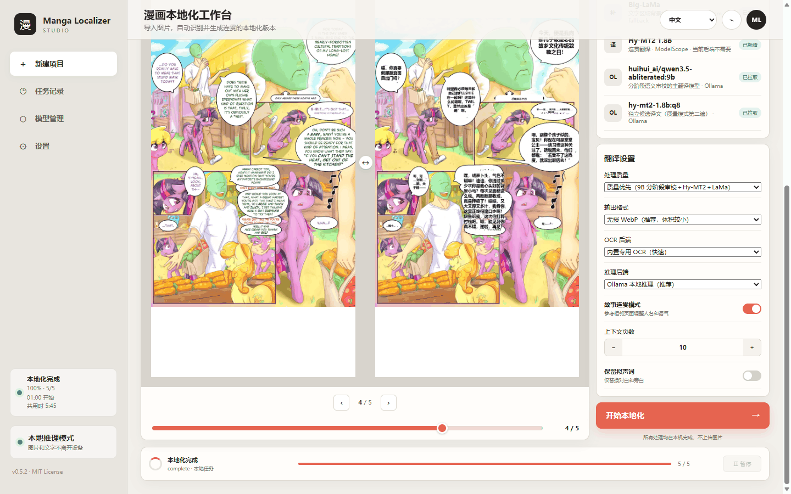
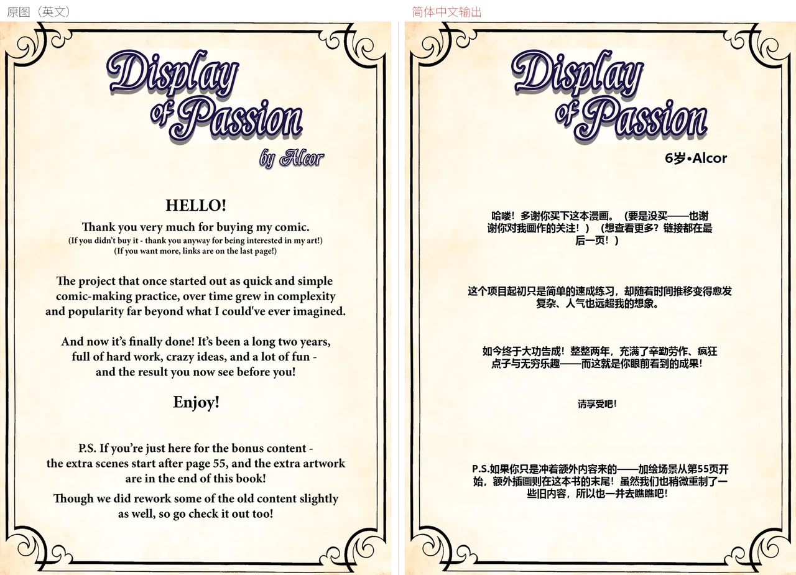
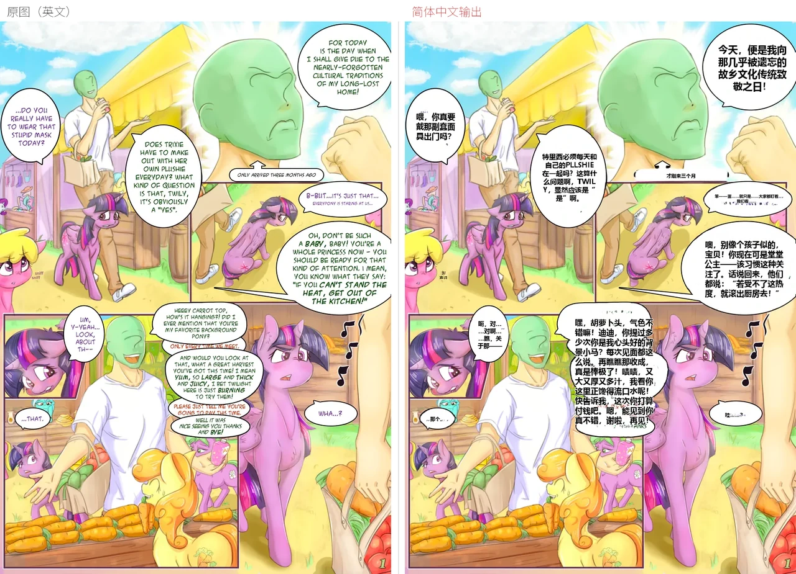
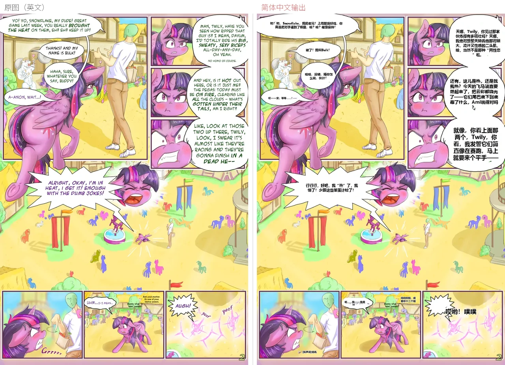
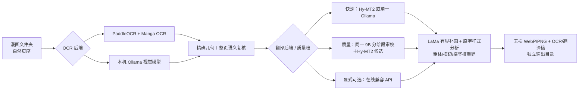

# Manga Localizer Studio · AMD 显卡个人适配版

本地优先的漫画中文化工作台：按自然页序检测文字、识别原文（日文／英文）、结合前后页保持剧情与称呼连贯，最后只在文字区域内重绘中文 —— **不覆盖源文件**，也不把整页图片丢给云端。

本仓库是 [whmc76/manga-localizer-studio](https://github.com/whmc76/manga-localizer-studio) **v0.5.2** 的个人分支：在上游基础上做了 **AMD 显卡（Radeon RX 9070 XT）+ Windows** 适配，并补齐了安全暂停、任务计时、英文源支持、模型页真实状态等一批本地改动。相对上游的逐条改动、踩坑与实测数据见 [`README-本地部署.md`](README-本地部署.md)；上游的设计基线见 [`docs/DESIGN_CONTRACT.md`](docs/DESIGN_CONTRACT.md) 与 [`docs/PARITY_LEDGER.md`](docs/PARITY_LEDGER.md)。



## 实机效果：原图与简体中文输出对比

下面三张图来自本机对 `[Alcor] A Display of Passion`（英文同人，My Little Pony）的真实运行：内置 OCR（PP-OCRv5 + Manga OCR）+ 本机 Ollama 9B 质量模式 + LaMa 补画 + 样式重建；没有人工人名表，也没有调用在线 LLM API。5 页共 30 个文字单元：替换中文 30 个、明确跳过 0 个、未解决 0 个、无效译文 0 个。







每张图左半是原图、右半是输出；README 只做等比例缩略展示，成品保持源图原始像素尺寸（800×1132），擦除与补画只发生在检测器确认的文字区域内。

## 本分支相对上游做了什么

- **AMD/Windows 适配**：不依赖 CUDA。设备选择在任何 `gpu*`/`cuda` 请求上先做可用性检查并回落到 `cpu`（Paddle、LaMa、Hy-MT2 三处），否则 AMD 机器上会死在 oneDNN 的 PIR 转换里、或抛 `Torch not compiled with CUDA enabled`。
- **翻译全部上显卡**：把同一份 Hy-MT2 1.8B 权重交给本机 Ollama（Vulkan）跑质量模式的第二遍候选，`MLS_HY_MT2_OLLAMA` 一行开关。单次候选调用从 CPU torch 的 9–74 s 降到 0.07–0.09 s；整本 71 页质量模式从 **22.5 min 降到 4.3 min**。
- **英文源支持**：原文语言自适应（`日文`／`英文`）的 prompt、拉丁页剔除检测器的无文本画面框、拉丁音效表与双写拟声词识别、横排字号下限放宽。修复前英文气泡会被 Manga OCR 读成假名幻觉、译文全错。
- **「已可接受的译文是终稿」守卫**：审校／重译轮只能救援被硬门槛拒绝的行，不再把编辑初译的好译文覆盖成更差的版本。
- **安全暂停**：页与页、chunk 与 chunk 之间暂停（模型与已完成页面都保留），暂停时段不计入计时；配合原有的「结束」与设置页「退出程序」。
- **更完整的 UI**：侧边栏任务状态卡（阶段／页数／开始时间／已用时间／预计还需）、页码滑动条、任务记录回填、模型管理页显示**实际在跑**的模型（含两条 Ollama tag 与真实大小）、三语言文案补齐。
- **输出目录自动推导**为 `{输出根}\{源目录名}--已汉化`，中间产物与成品都落在该子目录。
- **纯 ASCII 安装路径**的要求与本地启动脚本（见下）。

## 特性

- **中日英界面**：工作台可即时切换中文、日文和英文，并自动记住选择；界面语言与漫画目标语言相互独立。
- **故事连贯**：默认携带前 6 页成稿；扫描全书反复出现的片假名角色名，通过 JMnedict、中文姓名候选过滤和本地 9B 裁决生成一致性约束，不需要为具体作品维护人工人名表。
- **本地质量集成**：质量模式由同一个 9B 模型分阶段完成草稿、上下文裁决和语义风险复译，Hy-MT2 1.8B 提供独立候选；不下载或依赖 9B 以上模型。快速模式仍可只运行单一轻量模型。
- **质量 OCR**：Paddle 精确框 + Manga OCR 识别 + 9B 漏字／语义审计；视觉模型报告的漏字必须经过已有框覆盖判断、局部放大 Paddle 重检和 Manga OCR 独立确认，粗 VLM 框永远不直接擦图。
- **原字样式匹配**：不依赖多模态 LLM，直接分析横竖排、字号、字重、前景色、描边色／宽度、字距和展示文字占比；自动使用常规或粗体中文字体重排。
- **保护画面**：保持原始像素尺寸，不覆盖源图；LaMa 推理后强制逐像素恢复掩膜外区域，回归测试验证有界编辑契约。
- **本地后端可组合**：翻译与 OCR 都可选 **内置**、**本机 Ollama**、**本机 llama.cpp**（0.10.0 起，直接读 Ollama 已下载的 GGUF）或显式在线兼容 API；Ollama 路径完整保留，随时可作 fallback 切回。
- **隐私边界清晰**：本地模式不外传数据；在线模式只发送 OCR 文本和上下文，不上传图片。

## 环境要求

| 项目 | 要求 |
| --- | --- |
| 系统 | Windows 10/11（Linux 亦可，脚本在 `scripts/`）；主操作系统以外未做验证 |
| Python | **3.11 或 3.12**（`requires-python = ">=3.11,<3.13"`）。推荐装 [uv](https://docs.astral.sh/uv/)，缺它会自动回落到 `venv` + `pip` |
| 系统组件 | **Vulkan 驱动**（AMD / NVIDIA 均可）。本地大模型走 Vulkan，没有可用驱动时只会退回 CPU，速度会慢一个数量级 |
| 磁盘 | 纯代码约 3 MB；完整本地质量模式 **约 16 GB**（9B 主模型 8.3 GB + 7B 候选 5.9 GB + 1.8B 候选 1.9 GB，以及 Paddle / MangaOCR / LaMa） |
| 内存 | 建议 16 GB 以上。OCR 是纯 CPU，跑满 5–6 个核心 |

**参考配置**（本文档的实测环境）：AMD Ryzen 5 5600G（6 核 12 线程）+ AMD Radeon RX 9070 XT（16 GB，Vulkan）；torch 2.8.0+cpu / paddlepaddle 3.3.1 / paddleocr 3.7.0 / paddlex 3.7.2；便携 Ollama 0.40.14（只保留 vulkan 后端），llama.cpp 后端复用其中自带的 `llama-server.exe`（`0.8.0-dev`）。

> **显卡说明**：Paddle 没有 ROCm／DirectML 后端，所以 OCR 始终跑 CPU；GPU 只服务于 Ollama 与 llama.cpp 的翻译／视觉模型。NVIDIA 机器同样可用，装 CUDA 版 torch 也不会被用到，纯属浪费空间。

**安装路径必须是纯 ASCII。** Paddle 的 C++ 推理和 `torch.jit.load` 都打不开含中文的路径，会报 `json.exception.parse_error.101` / `open file failed because of errno 2`。目录名请保持纯 ASCII（例如 `D:\MangaLocalizer`），**不要带中文**；如果搬动目录，还要同步改 `.venv\pyvenv.cfg` 的 `home` 和 `site-packages\_editable_impl_manga_localizer_studio.pth`。

## 安装与启动

克隆后**一条命令就能跑起来**。`start.bat` 发现没有 `.venv` 时会自动调用 `scripts/bootstrap.ps1` 建环境、装依赖（首次需要几分钟、下载约 2 GB 的 Python 包），然后启动 UI：

```powershell
git clone https://github.com/aduiduid/Ai-Manga-Localizer---AMD.git
cd Ai-Manga-Localizer---AMD
.\start.bat
```

打开 <http://127.0.0.1:8765>。想先把依赖和权重都装齐（适合离线前预热），手动跑引导脚本：

```powershell
.\scripts\bootstrap.ps1 -Profile cpu            # 依赖 + 全部模型权重 + doctor 自检
.\scripts\bootstrap.ps1 -Profile cpu -SkipModels # 只装依赖，权重留给 UI 按需拉
```

> AMD 机器上**不要装 CUDA 版 torch**：本分支的设备回落逻辑本身就假设 `torch.cuda.is_available()` 为假，CUDA 轮子既用不到又会让 `torch` 体积翻几倍。`bootstrap.ps1` 的 `-Profile auto` 只在检测到 `nvidia-smi` 时选 `cuda129`，其余情况回落 `cpu`；AMD 机器请显式写 `-Profile cpu`。若本机没装 `uv`，脚本会自动回落到 `python -m venv` + `pip` 的兼容路径。

**启动脚本做了什么**：仓库根目录的 `start.bat` 会在首次运行时调用 `scripts/bootstrap.ps1` 建好 `.venv` 并装依赖，然后把 `MLS_HOME`、`PADDLE_PDX_CACHE_HOME`、`HF_HOME` 全部指向本目录的 `data\`，并把 `USERPROFILE`／`TEMP` 挪到 `_home\`（Paddle 会往 `~/.cache/paddle` 写）。所有缓存与权重都留在 checkout 内部，不污染 C 盘。

```
start.bat                              :: 打开 http://127.0.0.1:8765
start.bat run "D:\书\某本" -o "D:\书\某本--已汉化"
start.bat doctor                       :: 环境 + 实际模型清单
start.bat models status
```

`start.bat` 用 `%~dp0` 定位自己，所以在哪个目录 clone 都能用，不需要改脚本。它会把 `MLS_HOME`、`PADDLE_PDX_CACHE_HOME`、`HF_HOME` 指到 checkout 内的 `data\`，把 `USERPROFILE`／`TEMP` 挪到 `_home\`，**所有缓存与权重都留在项目目录内**。**改这个脚本必须保持 CRLF 行尾**，写成 LF 会被 cmd 拆碎成 `'Localizer' is not recognized...`。

## 模型获取

代码库里不含任何权重（`.gitignore` 排除了 `*.gguf`、`*.pt`、`*.safetensors` 等）。三种拿法，任选一种：

**1）UI 里点「准备缺失模型」** —— 只下载当前后端需要的那几个，最省事。

**2）CLI 一次性拉全** —— 走 `model_manager` 里固化的 URL 与 SHA-256 校验，原子写入：

```powershell
.\start.bat models download all     # 或单个：paddleocr / manga-ocr / lama / hy-mt2
.\start.bat models status           # 看清每个权重在不在、多大
```

**3）手动放置** —— 下表是每个文件的落点，下载后按目录丢进去即可：

| 权重 | 目标目录 | 大小 | 来源 |
| --- | --- | --- | --- |
| PaddleOCR（PP-OCRv5 det/rec） | `data\models\paddlex\` | ~130 MB | 首次运行自动拉，源固定为 ModelScope |
| Manga OCR | `data\models\huggingface\` | ~850 MB | `kha-white/manga-ocr-base`（HuggingFace，走 `HF_ENDPOINT` 镜像） |
| Big-LaMa | `data\models\lama\big-lama.pt` | 196 MB | [simple-lama-inpainting v0.1.0](https://github.com/enesmsahin/simple-lama-inpainting/releases/download/v0.1.0/big-lama.pt)，SHA-256 `7ba7aa7a…9e6b4c` |
| Hy-MT2 1.8B（CPU torch 后端用） | `data\models\hy-mt2\` | 3.9 GB | ModelScope `Tencent-Hunyuan/Hy-MT2-1.8B` |
| **GGUF 主模型 / 候选模型** | `data\llama-models\<名字>.gguf` 或 Ollama 的 blob 存储 | 见下 | 自行下载，或用 <https://ollama.com> |

**GGUF 怎么放**：llama.cpp 后端按**标签名**找权重 —— 字段里填 `HY-MT2-7B-Q6_K`，它就会去找 `data\llama-models\HY-MT2-7B-Q6_K.gguf`；填 `hy-mt2-1.8b:q8` 则先在 Ollama 的 manifest 里找，找不到再回退到同名裸文件。多模态视觉 OCR 还要求同目录下有 `<名字>-mmproj.gguf` 投影器，缺了会在启动前明确报错而不是静默跑错。

默认配置用到三个（都可以在设置页改）：

| 用途 | 默认标签 | 大约 |
| --- | --- | --- |
| 主译 + 视觉 OCR（多模态） | `DeepSeek-V4-Pro-Qwen3.5-9B-UNCENSORED-heretic.i1-Q6_K:latest` | 6.85 GB + 0.86 GB mmproj |
| 质量模式候选 | `hy-mt2-1.8b:q8` | 1.78 GB |
| 「7B 专精极速单跑」模式 | `HY-MT2-7B-Q6_K` | 5.74 GB |

> 如果只想先用起来，把「推理后端」选成 **内置 Hy-MT2（极速）**、**OCR 后端** 选 **内置专用 OCR**，就只需要 PaddleOCR + Manga OCR + Hy-MT2 1.8B，不用碰 GGUF。

## 使用

1. 右上角切换界面语言，选择漫画图片文件夹（JPG、PNG、WebP、BMP、TIFF）。
2. 输出目录会自动填成 `{输出根}\{源目录名}--已汉化`；换成别的目录也可以，但输出不能与源目录相同。
3. 选择 OCR 与翻译后端，按需设置「故事连贯」「前文页数」「保留拟声词」和输出格式（默认无损 WebP）。
4. 模型未就绪时点「准备缺失模型」；只会下载当前后端需要的权重。
5. 运行中可以**暂停**（当前页跑完停住，模型与已完成页面全保留）、**结束**（下一次进度回调停下，缓存复用）或从设置页**退出程序**。侧边栏卡片显示开始时间、已用时间与预计剩余。

CLI 与 UI 使用同一条流水线：

```bash
manga-localizer run "D:/manga/chapter-01" -o "D:/manga/chapter-01--已汉化"
manga-localizer run "D:/manga/chapter-01" -o "D:/manga/chapter-01--已汉化" --backend ollama --quality-profile quality
manga-localizer run "D:/manga/chapter-01" -o "D:/manga/chapter-01-fast" --backend ollama --quality-profile fast
manga-localizer run "D:/manga/chapter-01" -o "D:/manga/chapter-01-png" --output-format png
manga-localizer run "D:/manga/chapter-01" -o "D:/manga/chapter-01-final" --reviewed-transcript "D:/manga/transcript-reviewed.json"
manga-localizer models status
manga-localizer doctor
```

在线兼容 API 使用 `--backend online --online-url ... --online-model ...`，密钥通过 `MLS_ONLINE_API_KEY` 环境变量提供；UI 中输入的密钥只保留在当前服务进程内，不写入磁盘。

## 推理后端：Ollama 与 llama.cpp（0.10.0 起）

**两条全本地推理路径并存，Ollama 路径完整保留**，随时可以切回去：

| | Ollama | llama.cpp |
| --- | --- | --- |
| 服务 | 常驻守护进程（127.0.0.1:11434） | 按需起 `llama-server.exe`，任务/批次结束即 kill 并交还显存 |
| 权重 | `ollama-models\blobs\` 里的 GGUF | 硬链接复用**同一批 blob**，不复制、不转换 |
| 翻译 | `inference_backend=ollama` | `inference_backend=llama` |
| OCR | `ocr_backend=ollama`／`hybrid` | `ocr_backend=llama`（与 hybrid 同一套「几何＋语义」流程，只换视觉传输） |

### 推荐使用策略（2026-11-09 A/B 实测，完整报告见 [`docs/ollama-vs-llamacpp-ab.md`](docs/ollama-vs-llamacpp-ab.md)）

| 素材 | 推荐 | 实测依据（同机冷启动、同一流水线、唯一变量是后端） |
| --- | --- | --- |
| 英文／西文书 | **llama.cpp** | 端到端 1873.0 s vs 1896.2 s（打平，最密 36 单元页反而快 7%），OCR 显存峰值省 1.0 GB（8133 MB vs 9167 MB），且不留常驻进程 |
| 日文竖排书 | **Ollama**（0.10.3 之后 llama.cpp 已能追平单元数，但读数与超小字仍差一截） | 单页 107.8 s vs 313.7 s（快 2.9×）。llama.cpp 在 0.10.3 前少认 3/12 个手写拟声单元；补齐后单元数 **12/12 稳定**，但其中两个位置的读数被 Paddle 读成 `ハア`／`な`，且 27×26 px 的那个仍然检不出 |

两条路的几何层完全相同 —— hybrid 流程下逐单元 bbox **IoU 全 1.0、坐标零漂移**，差异只在 VLM 的 `artwork_text`／`sfx` 判定上。**不建议卸载 Ollama**：模型 blob 是两条路共享的硬链接，删掉程序本体只能腾出 41 MB（报告第六节）。

**怎么配**：在项目面板或设置页把「推理后端」选成 `llama.cpp 本地推理`，「OCR 后端」选 `llama.cpp 视觉 OCR`，模型名沿用 Ollama 里那两个 tag（默认已填好）。

| 设置 | 默认值 | 说明 |
| --- | --- | --- |
| 主模型 | `DeepSeek-V4-Pro-Qwen3.5-9B-UNCENSORED-heretic.i1-Q6_K:latest` | 同一份多模态 9B 供翻译与视觉 OCR 共用 |
| 审校模型 | `hy-mt2-1.8b:q8` | 质量模式的独立候选译文 |
| 上下文 | `65536` | 需要时可在 4096–262144 之间调 |
| 端口 | 主 `8080` / 审校 `8081` / 视觉 OCR `8082` | 被占用时自动顺延并在任务日志里说明；整段被占则明确报错 |
| llama-server 路径、Ollama 模型目录 | 留空 | 留空时自动在 `_dl\ollama\lib\ollama\` 与 `ollama-models\` 下查找 |

启动参数由程序拼装（`-ngl 99 -fa on -rea off -np 1 -ctk q8_0 -ctv q8_0 --no-webui`），并先在 `data\llama-models\runtime\` 里备好一份私有运行时：`llama-server.exe` 与 `ggml-vulkan.dll` 必须同目录，否则 llama.cpp 找不到 GPU 会静默回落到 CPU。视觉 OCR 要求模型带 mmproj 投影器（缺失时启动前就报错）；同 tag 的模型会被复用，不会为 OCR 再加载一份 7 GB 权重。页面在送进视觉模型前会转成 PNG（llama.cpp 拒收 WebP）。

CLI 与 UI 走同一条流水线，`--backend llama`／`--ocr-backend llama` 会沿用你保存的设置，单个 `--llama-*` 参数可覆盖本次运行：

```bash
manga-localizer run "D:/manga/chapter-01" -o "D:/manga/chapter-01--已汉化" --backend llama --ocr-backend llama
manga-localizer run "D:/manga/chapter-01" -o "D:/manga/chapter-01-llama8083" --backend llama --llama-main-port 8083
```

本机实测（2026-11-09，英文 5 页 + 日文竖排 1 页，两边都是冷启动）：**英文密集页两条路几乎打平** —— 端到端 1873.0 s vs 1896.2 s，最密的 36 单元页 623.8 s vs 580.1 s；单页耗时由单元数主导（0 单元 ≈ 20 s、36 单元 ≈ 600 s），两组都会出现长尾。llama.cpp 的收益是**显存峰值少 1.0 GB** 且跑完不留进程。**日文竖排页 Ollama 更好**（107.8 s vs 313.7 s；0.10.3 之前还多认 3 个单元，详见下面那节）。llama.cpp 启动 6.55 s、34/34 层全部 offload、KV 用 q8_0。

> 此前"llama.cpp 每页 43–45 s vs Ollama 偶发 333 s"只在 **4 个单元的小页**上成立，**不可外推到密集页**；以 [`docs/ollama-vs-llamacpp-ab.md`](docs/ollama-vs-llamacpp-ab.md) 的逐页表为准。

### 日文竖排的召回修复（0.10.3）

llama.cpp 在密集竖排页上会把三处手写小字整段漏掉。逐阶段实测后确认差距发生在**提案**阶段，不是去重也不是阈值，为此加了两条互补的机制：

- **`scores_are_informative()`** —— 视觉模型给出的 `score` 有时不带信息量：llama.cpp 对每一处提案都答同一个 `-0.0126953125`（两次运行逐字节相同），而旧的 `0.72`／`0.75` 门限会把这些提案**全部否决**。该函数在「全部 ≤0、饱和（≥0.99 过半）、或极差 <0.05」时判定分数无意义，此时跳过门限、让提案进入几何复核；Ollama 那种 0.71–1.00 的正常分布不受影响。
- **`ink_tile_hints()`** —— 一个什么都不提的模型会让召回无从下手，所以按固定的 3×4 网格扫描页面，跳过无墨块（`(region<140).mean() < 0.02`）与 detector 已覆盖 ≥55% 的块，把剩下的交给既有的 `recover_missing`。**tile 只是提案**：每一块仍要过 Paddle 重检测和一次独立的 MangaOCR 日文读取才能成为单元，这也正是英文 5 页 129 单元、10 个 artwork 跳过**逐单元零变化**的原因。
- 另配套修了嵌套去重：小音效只有在大框**已经包含同样文字**时才算重复（`びっ` 落在 `バアン` 里不再被无脑丢掉）。

同一页连跑三次均为 12 单元（Ollama 的数量）、无丢失；代价是那两个位置的读数偏差与那个 27 px 小字，见 TODO。

## 性能优化（0.10.5 / 0.10.6）

两条已落地的吞吐优化。验收标准是 **OCR 单元与逐单元判定逐字段不变、成图只有措辞差异**（LLM 采样本身非确定，而渲染器已实测为确定性：同一份 transcript 连渲两遍 0 px 差）：

| 版本 | 改动 | 5 页英文参考集实测 |
|---|---|---|
| 0.10.5 | 声明 `source_language=en` 时不再要 `find_missing`／`ink_tile_hints` 的提案 —— 把提案写回几何的那次回读是日文专属，`recover_missing` 对 `en` 直接返回原页，那些提案永远是死几何，却占每页 13 到 21% 的时间 | OCR 1314.1 到 1027.6 s（**-21.8%**）、整轮 1707.1 到 1430.3 s（**-16.2%**），129 个单元与逐单元判定逐字段相同 |
| 0.10.6 | 密集批次不再丢尾：预算按源字符三倍动态放大到 4096、一批最多 40 个单元；`[拟声词]` 标签不再计入长度；短促拟声允许共用译文；候选模型回显长上下文时改用无上下文重试 | 翻译层模型调用 **265 到 61 次**、回退 9 到 1（9B 首译）与 128 到 33（候选）、291.3 到 230.3 s；129 个单元、`unresolved 0` 不变 |

`auto` 源语言仍保留召回提案（拉丁页在 `auto` 下会走召回）。被否决的优化：`refine_local_crops` 四张裁剪一包能把这阶段从 328 s 压到 84 s（3.9 倍），但**模型对同一张裁剪图的 `role` 判定会变**（`RISE`／`PUMP` 单张答 `artwork`、四张一包答 `sfx`），两个美术字因此被擦掉重排 —— 模型改口不是阈值能救的，因此审计保持一张一请求。完整数据见 [`docs/performance-audit-2026-11-09.md`](docs/performance-audit-2026-11-09.md)。

## 工作原理



| 模块 | 默认方案 | 下载策略 |
|---|---|---|
| 文字定位 | PP-OCRv5 mobile det + server rec（CPU） | PaddleX 强制 `modelscope` 源 |
| 文字识别 | Manga OCR（日文）；英文页走 Paddle 识别结果 | 上游源回退，并在 UI 标明 |
| 连贯翻译 | 同一 9B 分阶段草稿／审校 + Hy-MT2 独立候选（均走 Ollama/Vulkan） | Ollama 自动拉取；不使用 9B 以上模型 |
| 画面修复 | Big-LaMa（质量）/ OpenCV（快速） | 约 196 MB，SHA-256 校验、原子下载 |
| 样式与排字 | OpenCV 分析 + Noto CJK Regular/Bold + Pillow | 不调用 LLM，不联网 |

模型与缓存都在项目目录内（`data\models`、`ollama-models\`），也可以用 `MLS_HOME` 改变位置；字体默认取系统 Noto Sans CJK SC，可用 `MLS_FONT` 指向自己的 TTF/OTF/TTC。

## 已知限制

- **OCR 是纯 CPU**：RX 9070 XT 只能给 Ollama 用 Vulkan，Paddle 没有 ROCm/DirectML 后端。整本 71 页质量模式实测约 3.6 s/页。
- **没有气泡、直接画在背景上的小字可能漏检**：把 PaddleOCR 短边放大到 1280 能读出来，但整页识别慢 32% 并引入噪声框，因此没有默认开启。
- 专有名词（书名、人名）单次翻译容易误译；质量模式已启用候选 + 9B 审校，仍不保证。
- 白描边小字擦除后可能留淡残影，改用 `quality_profile=fast` 或手动框可以规避。
- `preserve_sfx=True` 时英文音效按原样保留（`Grrrrr`、`poof` 等），不会译成中文拟声词。

## TODO / 后续优化方向（只记录，未实现）

日文竖排页目前单元数已追平 Ollama（12/12），剩下的是**读数精度**与一个**绝对盲区**。这两件事都不是调阈值能解决的，属于另一个量级的改动：

- **27×26 px 的超小字**：`びっ` 这类反应记号在 2× 放大后仍低于检测器的有效尺度 —— 实测所有 padding（0.15／0.5／1.5）与放大倍率（1×／2×／4×）组合都返回 0 个 region。候选方向：给面积低于某阈值的 hint 单独开一条高倍率（4×）路径，并配合按块自适应而不是整页统一放大。
- **`recover_missing` 的读数偏差**：`バアン` 位置找回来了但被 Paddle 读成 `ハア`，`びっ` 读成 `な`。这是 2× 放大下 Paddle det + MangaOCR 的组合结果，换网格或换几何都改不了。候选方向：让多读一致性投票（`rescue_reading_is_stable` 那套）也覆盖这条路径，或用 VLM 的读数与 MangaOCR 的读数做二次仲裁。
- **mmproj 的输入分辨率**：尚未验证是否有可调空间，若能提高视觉编码器的有效分辨率，可能同时改善上面两条。需要先在 llama.cpp 侧确认 `--mmproj` 有没有对应参数。

## 设计与工程约束

- 检测、补画和排字规则只使用图像／文字单元特征，不包含作品标题、对白、页号、文件名或固定坐标。
- 原始图片从不被覆盖；API 也拒绝相同的源／输出目录。
- 像素变化限制在检测框周围的有界清理区；边缘连通的角色、背景和分镜线会被保留，回归测试覆盖该约束。
- 翻译保留稳定单元 ID，模型漏行或返回原文时逐条补译，避免气泡错位。
- 审校稿中的跳过项必须使用 `duplicate`、`noise`、`decorative` 或 `preserve` 之一作为 `skip_reason`；缺失原因的旧稿会被安全地视为未完成。
- 模型状态、进度、历史和预览均来自真实本地 API，不使用伪造 UI 状态。

## 开发与测试

```powershell
uv lock --check
uv run --frozen --no-sync pytest
uv run --frozen --no-sync manga-localizer ui --no-open
uv run python scripts/verify_output.py SOURCE OUTPUT OUTPUT/.manga-localizer-work/transcript.json
```

本机实测（0.10.3）**342 个测试收集、除下述 1 个外全部通过**。唯一未通过的是 `tests/test_inpainting.py::test_lama_wrapper_preserves_every_unmasked_pixel`：`torch.jit.save` 打不开本机中文临时目录（pytest 的 `tmp_path` 落在中文路径下），属环境限制而非代码问题：

```powershell
python -m pytest tests --deselect tests/test_inpainting.py::test_lama_wrapper_preserves_every_unmasked_pixel
```

## 许可证与模型说明

项目源码使用 [MIT License](LICENSE)。下载的模型权重不随仓库分发，沿用各自上游许可证；详见 [MODEL_LICENSES.md](MODEL_LICENSES.md)。请只处理你有权翻译和发布的内容。

## 致谢

上游项目 [Manga Localizer Studio](https://github.com/whmc76/manga-localizer-studio) 由 **赛博迪克朗**（[@whmc76](https://github.com/whmc76)）开发并维护，本分支的 AMD／中文适配建立在 v0.5.2 之上。

核心能力来自 [PaddleOCR](https://github.com/PaddlePaddle/PaddleOCR)、[Manga OCR](https://github.com/kha-white/manga-ocr)、[LaMa](https://github.com/advimman/lama)、[ModelScope](https://modelscope.cn/) 与 [Hy-MT2](https://modelscope.cn/collections/Tencent-Hunyuan/Hy-MT2)。
